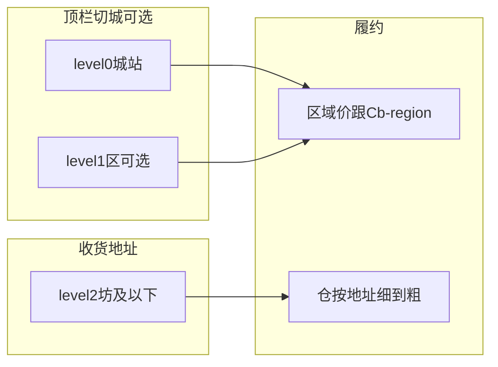

# 切城用城/区 + 同城下单 + 订单提货仓

## 推荐结论（答「省是不是太大」）

**越南这套 level 和中国「省很大」不是一回事：**

| level | VN 例子 | 商业含义 |
|-------|---------|----------|
| -1 | Việt Nam | 国家 |
| **0** | Hà Nội / HCMC / Đà Nẵng | **城站**（中央直辖市），对应客户说的「河内仓、胡志明仓」——**推荐默认切城粒度** |
| **1** | Ba Đình 等郡 | **区**——一城多仓、区分价时再开放 |
| 2 | Phúc Xá 等坊 | 只做**收货地址**，**不要当切城选项** |

所以：不是切「中国那种省」，而是切 **市（level0）**；需要时再加 **区（level1）**。坊不做顶栏选项，从根上避免兄弟坊 `Cb-region` 互斥。

**推荐运营策略：**

1. 默认开放/热门：**level0 城**（河内、胡志明、岘港…）。
2. 某城下一区要独立仓或独立价，再把该 **level1** 设 `is_open`（如只开 Ba Đình）。
3. 坊保持可作地址，但切城 API / 热门列表 **不下发 level≥2**。

**下单校验推荐：**

- 主规则仍优先：`地址 ∈ 所选销售区`（选了 Ba Đình，地址在福舍 → 通过）。
- 兼容：若历史或定位落到坊级 `Cb-region`，则 **level0 祖先相同即通过**（兜底，修当前 400）。
- 跨城（河内地址 + 胡志明切城）仍拒绝或提示切换。

仓匹配逻辑不变（地址细→粗 / `exact_match_only`）。

**不推荐本期**：顶栏直接改成仓库列表（可二期）；把切城做成「仓关联坊树」。

## 本期实现

### 1. 同城兼容校验

[RegionServices.php](crmeb/app/services/vn/RegionServices.php)：`addressCompatibleWithRegion` = `addressInRegion` OR 双方 level0 祖先相同。  
[StoreOrderCreateServices.php](crmeb/app/services/order/StoreOrderCreateServices.php) 改用；文案「收货地址与当前配送城市不一致」。单测覆盖兄弟坊 / 跨城。

### 2. 切城列表颗粒度（小改）

H5 `region/children`、`region/hot`（及前端切城入口）：可选节点 **level ≤ 1**（或配置「切城最大 level=1」）。地址选择仍用 `address_children` 全层级。

### 3. 订单详情提货仓

- H5 [order_details/index.vue](template/uni-app/pages/goods/order_details/index.vue)
- 管理端 [orderDetails.vue](template/admin/src/pages/order/orderList/handle/orderDetails.vue)
- 核对 `warehouse_*` 是否随详情返回。

### 4. 文档

[261029-仓库与区域匹配方案.md](docs/260409-菜集鲜/261029-仓库与区域匹配方案.md)：切城 = 城+可选区；地址到坊；同城兼容；仓按地址。

## 不做（本期）

- 仓维价格；顶栏仓列表（二期 B）
- 跨城有仓即可下单
