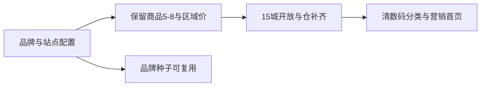

# 合同后初始调整计划

## 现状结论（线上公开 API + 开发库对照）

**生产 MySQL MCP（`user-mysql-crmeb-cjx-prod`）当前不可用**：TCP `139.180.131.121:3306` 通，但账号 `cjx_crmeb` 对出口 IP `171.246.140.39` 报 `Access denied`。因此订单/用户/区域价明细等库内表尚未直接核对；下列结论来自 `https://khonguon.alphavn.shop` 公开接口。

### 已是非默认、建议保留

| 类型 | 线上现状 | 处理 |
|------|----------|------|
| 品牌站名/域名 | `site_name=Kho Nguon`，`site_url=https://khonguon.alphavn.shop` | 保留并微调为完整展示名 |
| 生鲜商品 | id **5–8**：`hành tây` / `cà rốt` / `củ cải trắng` / `khoai tây`；图在 `uploads/attach/2026/11/06/`；`is_fresh=1` | **整包保留**（含图、库存、规格） |
| 区域价 | 同品河内/胡志明价不同（如土豆 28000 vs 31000） | **保留**；后续只补其他城价 |
| 开放省 | 河内、胡志明、岘港、海防、清化、北宁、顺化（7/15） | 保留并扩到 15 城 |
| 提货仓 | `WHINIT:KHO-HA-NOI/BAC-NINH/HUE/TP-HCM`（CSV 示意地址） | **保留**；清化改真实地址；缺仓城按 A 方案补占位仓 |

### 明确要改/清

| 类型 | 线上现状 | 处理 |
|------|----------|------|
| Logo | 仍指向 `/statics/system_images/*.png|jpeg` | 换为 [`docs/260409-菜集鲜/logo.jpg`](docs/260409-菜集鲜/logo.jpg) |
| 版权/联系 | 版权仍 `Alpha Fangding`；电话/地址/`vn_contact` 空 | 改为合同信息 |
| 关于我们 | 安装包通用商城文案 | 改为 Kho Nguon / 源仓 |
| 分类 | 仍是数码大树 + `Rau củ(41)`；土豆误挂 `1,10` | 收敛生鲜分类，修正挂载 |
| 旧商品残留 | id 1/4 存在但区域不可售；2/3 不存在 | 下架/删除数码残留，不动 5–8 |
| 首页主题 | 仍含秒杀/砍价/拼团/promotionList | 改成 B2B 生鲜首页 |
| 缺口城/仓 | 另 8 城未开；岘港/海防/清化无仓 | 开城 + 每城默认仓（地址可「待补充」） |

## 命名与联系信息约定

- 对外展示 `site_name`：`Kho Nguon | 源仓`
- 软件短名（管理端 title / PWA short_name / `VUE_APP_TITLE`）：`KHO.NGUON`
- 域名：`https://khonguon.alphavn.shop`（已配，核对绝对 URL 残留）
- 电话：`+84 988 619 355`；邮箱：`s0969980920@gmail.com`
- 联系人写入关于我们 + `vn_contact` 备注/账号文案：石雄飞 / NGUYỄN THỊ NHÂN / TRƯƠNG THỊ THU HIỀN
- 清化仓地址：`136 nguyễn duy hiệu,p.hạc thành-thanh hoá`

## 调整落点清单

### A. 品牌与站点（库配置 + 静态资源）

主通道：`eb_system_config`（后台设置）

- Logo：`site_logo` / `site_logo_square` / `login_logo` / `wap_login_logo` / `pc_logo` → 上传替换或覆盖 [`crmeb/public/statics/system_images/`](crmeb/public/statics/system_images/)
- 联系：`contact_number`、`customer_phone`、`company_address`（可用清化仓）
- 版权：`nncnL_crmeb_copyright`（去掉 Alpha Fangding）
- 组合数据 `vn_contact`（[`crmeb/database/vn/081_vn_contact.sql`](crmeb/database/vn/081_vn_contact.sql)）：phone + email
- `eb_agreement` type=7 关于我们

硬编码需改并重建前端：

- [`template/admin/.env*`](template/admin) `VUE_APP_TITLE`
- [`template/uni-app/manifest.json`](template/uni-app/manifest.json)、[`index.html`](template/uni-app/index.html)、[`static/pwa/manifest.webmanifest`](template/uni-app/static/pwa/manifest.webmanifest) 与 PWA 图标
- [`template/uni-app/static/agreements/**`](template/uni-app/static/agreements) 去掉「菜集鲜（演示站）」
- favicon / admin 兜底 `assets/images/logo*`

### B. 城市 / 仓库（运营数据，少改代码）

入口：后台「配送区域」「提货仓库」；或扩写 [`docs/260409-菜集鲜/初始业务数据模板/02_城市仓价格.csv`](docs/260409-菜集鲜/初始业务数据模板/02_城市仓价格.csv) + [`import_vn_init.py`](docs/260409-菜集鲜/初始业务数据模板/tools/import_vn_init.py)

15 城：河内、北宁、海阳、海防、清化、荣市、洞海、顺化、岘港、归仁、绥和、芽庄、大叻、胡志明、芹苴

规则（已拍板 A）：

1. 保留现有 4 个 `WHINIT:*` 仓与关联
2. 清化新建/补仓并写入真实地址
3. 其余缺仓城：一城一默认仓，地址暂「待补充」
4. 未开放的 8 城：`is_open=1`，热门按需（先河内/胡志明）
5. 保持官方 `store_self_mention=0`，继续走 VN 提货仓匹配（不要用 `eb_system_store`）

### C. 商品 / 分类 / 首页（保留近期生鲜）

**商品策略（基于线上 API，待你确认后执行）**：

- **保留** id 5–8 及对应区域价、图片附件
- **清理** 数码分类树与不可售旧品（1/4 等），土豆改挂生鲜分类
- 生鲜分类以 `Rau củ(41)` 为起点整理（可再拆根茎/叶菜等，先最小：一个可用一级分类）
- 首页改启用主题 [`eb_theme.home_data`](template/uni-app/pages/index/index.vue)（不是只改 `eb_diy`）：去掉秒杀/砍价/拼团等，保留分类宫格 + 商品列表
- 「我的」组合数据去掉充值/推广/券等营销入口（与 VN 隐藏策略对齐）

> MCP 能连库后补核：`eb_store_product_region_price`、订单、测试用户、附件是否还有更多应保留行。

### D. 可配置复用（同分支最小方案）

不做多租户。新增一份品牌种子，便于复制到同分支项目：

- 建议路径：`crmeb/database/vn/brand/khonguon_brand_seed.sql`（或 `docs/260409-菜集鲜/brand/`）
- 内容：`site_name`/`site_url`/版权/电话/邮箱/`vn_contact`/关于我们摘要
- Logo 文件约定路径 + 可选拷贝说明
- 城市仓仍走现有 CSV 模板，把 15 城写入 `02_城市仓价格.csv` 作为项目模板

## 建议执行顺序

1. **先修生产 MCP**：给 `cjx_crmeb@171.246.140.39` 授权（或 SSH 隧道），导出应保留数据清单（商品/区域价/仓/订单）
2. 备份生产库 → 开发库对齐验证
3. 品牌种子 SQL + Logo/PWA/协议硬编码
4. 15 城开放 + 占位仓 + 清化真实地址（保留现有 WHINIT）
5. 清理数码分类/旧品；修正 5–8 分类；收敛主题首页与「我的」
6. 域名绝对 URL 排查（按 [`docs/deploy/站点域名与静态资源切换说明.md`](docs/deploy/站点域名与静态资源切换说明.md)）→ 清缓存 → 冒烟（选城看价 → 匹配仓 → 下单）

## 你确认后即可开干的默认假设

- 商品：**保留线上 5–8 生鲜及区域价**，不整库清空商品
- 仓：方案 A（缺址用「待补充」）
- 先改开发环境验证，再生产；生产直接改库前必须 MCP/备份可用
