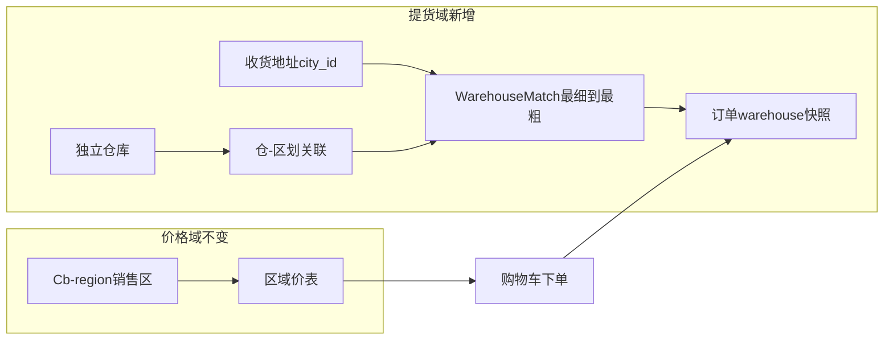

# 菜集鲜独立仓库与区域匹配方案

## 1. 讨论结论（背景）

客户简版需求（[docs/260409-菜集鲜/261029-客户需求.md](docs/260409-菜集鲜/261029-客户需求.md)）四点：注册、切城差异价、网站下单次日指定仓提货现金付、后台打印提货清单。

现状对照：

| 客户点 | 现状 | 结论 |
|--------|------|------|
| 注册账号 | VN 登录裁剪/风控已有 | 基本匹配 |
| 切城差异价 | 配送区域 + `RegionPriceServices` | 价匹配；**无仓实体** |
| 次日指定仓提货 + 现金 | 到付 COD 有；履约偏配送送达；`eb_system_store` 本地 0 条 | 半匹配 |
| 提货打印 | 到付打印/拣货汇总有 | 基本匹配 |

**库内没有独立「仓库」设计。** 官方 `eb_system_store` 是 CRMEB「提货点/门店自提核销」，含名称地址与营业时段字段，但实现方案明确 **不用门店价冒充区域价**；菜集鲜主链路是区划 `region_id` + 区域价，订单不落仓。不是「门店已充当区域仓」的已交付能力。

方案 A（一城一仓约定）vs 本方案：

| 维度 | 方案 A | 独立仓库（本方案，已选） |
|------|--------|--------------------------|
| 配置入口 | 无；靠开放热门城约定 | 仓主数据 + 区划关联后台 |
| 一城多仓 | 不支持 | 支持排序 / 默认 |
| 任意颗粒度挂载 | 无 | 国/省/市/郡/坊均可关联 |
| 地址倒查匹配 | 无 | 最细→最粗 + 精确/模糊开关 |
| 生效/提货时段 | 无 | 仓级可配 |
| 多语 | 借区划名 | 仓名/地址/说明走 `eb_i18n_content` |
| 改动量 | 近零 | 中等（新表+匹配服务+下单/打印） |
| 贴合简需「指定仓提货」 | 弱 | 强 |

**已拍板：**

1. 下单：**自动匹配默认仓**，用户可在**同匹配集**内改选。
2. 价格：**继续按配送区域/区划取区域价**；仓只负责提货点、订单快照、打印/核销展示。
3. 管理端到付单：**必须**支持按提货仓筛选（并可与现有 `region_id` 销售区筛选并用），方便仓管看「本仓订单」。
4. 配置可售卖/开放区域时：**支持快捷指定该区划节点的默认提货仓**；若该节点已有默认仓关联，**提示并二次确认后覆盖**。
5. 管理端以「少步骤、少概念、可发现缺口」为原则（见 §5.1 / §8）。

执行时先把本文写入专题文档：`docs/260409-菜集鲜/261029-仓库与区域匹配方案.md`（不改代码前先落文档也可随实现同批提交）。

---

## 2. 目标模型

- **销售区**（现有）：用户切城 → `Cb-region` → 区域价/可售。
- **提货仓**（新增）：下单地址 `city_id` 链 → 匹配仓库列表 → 默认仓可改 → 订单快照。
- **不复用** `eb_system_store` 做仓主数据（避免与官方自提/核销员模型缠在一起；匹配开关、多对多区划、精确匹配等字段也不适合硬塞门店表）。

---

## 3. 数据设计

### 3.1 `eb_vn_warehouse`（仓主数据）

| 字段 | 说明 |
|------|------|
| `id` | PK |
| `code` | 可选业务编码，唯一（可空则仅 id） |
| `name` / `address` / `detailed_address` / `introduction` | 主表存默认语（与 i18n 约定一致，默认 vi-VN） |
| `phone` / `lng` / `lat` | 联系与地图 |
| `is_enable` | 是否可用 |
| `effective_start` / `effective_end` | 生效失效（int 时间戳，0=不限） |
| `pickup_weekdays` / `pickup_time_start` / `pickup_time_end` 或 JSON `pickup_slots` | 可提货时段（一期用 JSON：`[{weekday:1-7,start,end}]`，空=不限制展示） |
| `auto_match` | 1=参与自动匹配；0=不进 H5 自动/候选集（后台仍可维护，预留人工指定） |
| `exact_match_only` | 1=仅当地址最细 `city_id` **等于**关联节点时命中；0=允许祖先模糊命中 |
| `sort` | 仓自身全局排序（同优先级时的次级排序） |
| `is_del` / `add_time` / `update_time` | 常规 |

多语：`eb_i18n_content`，`entity_type='warehouse'`，字段 `name|address|detailed_address|introduction`（沿用 [crmeb/database/vn/050_i18n_content.sql](crmeb/database/vn/050_i18n_content.sql)）。

### 3.2 `eb_vn_warehouse_region`（仓 ↔ 任意颗粒度区划）

| 字段 | 说明 |
|------|------|
| `warehouse_id` | FK |
| `city_id` | `eb_system_city.city_id`，任意 level |
| `sort` | 该节点下候选排序（大者靠前） |
| `is_default` | 该节点下是否默认仓 |
| UNIQUE(`warehouse_id`,`city_id`) | |
| KEY(`city_id`) | 倒查用 |

同一 `city_id` 下允许多仓；`is_default=1` 建议业务层保证「同一 city_id 至多一个默认」（保存时把同节点其它默认清 0）。

### 3.3 订单扩展（`eb_store_order`）

新增：`warehouse_id`、`warehouse_name`、`warehouse_address`（下单语言快照，打印/历史不随主数据改名漂移）。

**管理端到付列表筛选（本期必做，非可选项）：**

| 筛选项 | 用途 |
|--------|------|
| `warehouse_id` | 本仓订单；下拉为启用中的仓 |
| `region_id` | 沿用现有销售区筛（下单时的 `Cb-region` 快照） |
| 履约状态 / 日期 / 关键词 | 现有能力保留 |

列表列展示：提货仓名（快照）、销售区名。提供轻量快捷：「本仓 + 待提货 + 今日」组合（前端预设筛选，不新接口）。批量打印/拣货汇总**继承当前仓筛选**，避免打错仓单。

到付履约语义文案改为「备货 → 待提货 → 已提货」为主（状态码继续复用 `fulfil_status` 0–3）。

迁移：`crmeb/database/vn/031_warehouse.sql`（序号接在区域价 030 后），幂等风格与现有 `eb_vn_add_column` 一致。

---

## 4. 匹配算法（核心）

输入：地址最细 `city_id`（或下单时地址快照）。  
辅助：`system_city.path` 解析祖先链，**近→远**：`[自身, 父, …, 国家根]`（与 [RegionPriceServices::chain](crmeb/app/services/product/RegionPriceServices.php) 同思路）。

步骤：

1. 过滤仓：`is_del=0`、`is_enable=1`、在生效窗内、`auto_match=1`。
2. 查关联：`city_id IN chain`，JOIN 上步仓。
3. **精确约束**：若仓 `exact_match_only=1`，仅保留 `关联.city_id == 地址最细 city_id` 的行（祖先关联无效）。
4. **粒度择优**：在剩余关联中，取「关联节点在 chain 中索引最小」的那一层作为**获胜粒度**（有最细命中则不用更粗）。
5. **匹配集** = 获胜粒度上的全部候选仓；排序：`is_default DESC` → `关联.sort DESC` → `仓.sort DESC` → `id ASC`。
6. **默认仓** = 匹配集第一条；若该粒度无 `is_default`，仍按排序取第一条。
7. 无候选 → 返回空；下单拦截：「当前地址暂无可用提货仓」。

用户改仓：只能改选**本次匹配集**内的 `warehouse_id`（服务端二次校验，防篡改）。

可选后续（本期不做）：`auto_match=0` 的仓仅后台手工派单。

---

## 5. 接口与页面（最小闭环）

### 管理端 — 提货仓库

- 菜单：设置 → **提货仓库**（与「配送区域」并列）。`vn_mode` 下将官方「提货点/门店」菜单 `is_show=0`（不删代码），减少「两个仓概念」误操作。
- 页：仓 CRUD；**高级选项折叠**（默认展开只需：名称、地址、电话、启用；`auto_match`/`exact_match_only`/生效窗/提货时段放折叠区，新建默认 `auto_match=1`、`exact_match_only=0`）。
- 关联区划：树多选 + 每节点 sort/默认；保存时同 `city_id` 仅保留一个 `is_default`。
- **快速开仓向导**（一城一仓主路径）：名称+地址 → 选一个开放区划节点 → 自动写关联且 `is_default=1`；若该节点已有默认仓 → 二次确认覆盖。覆盖后再进「完整编辑」挂多区/多仓。
- 多语：复用 i18n 页，`entity_type=warehouse`。
- 服务：`WarehouseAdminServices`；API `adminapi/warehouse/*`。

### 管理端 — 配送区域快捷设默认仓（本期必做）

在现有「配送区域」节点操作区增加：**设默认提货仓**。

- 下拉数据：优先列出**已关联本 `city_id`** 的仓；并提供「选用其它仓并建立关联」入口（选仓后 upsert `eb_vn_warehouse_region`）。
- 若本节点已有 `is_default=1` 的其它仓：弹窗文案标明「当前默认：XXX，将改为：YYY」，确认后清旧默认、写新默认（可顺带确保关联行存在）。
- 节点列表/详情轻量展示：`默认仓：xxx` / `未配置默认仓`（红色提示），与开放白名单同一视线，避免「城开了但没仓」。

不在「开放可售」开关里静默改仓（避免误触）；快捷设仓是**显式按钮**，与 `is_open` 解耦但同页可达。

### 管理端 — 到付订单

- 筛选项与列见 §3.3；打印/拣货汇总带仓抬头并尊重仓筛选。

### 用户端 / 下单

- `GET warehouse/match?city_id=`：`{default_id, list:[…]}`。
- 确认订单：默认仓 + 可切换；提交 `warehouse_id`。
- [StoreOrderCreateServices](crmeb/app/services/order/StoreOrderCreateServices.php)：地址∈销售区校验后匹配校验并写仓快照；**价格路径不改**。

### 与切城关系

- 切城只影响价与可售；仓匹配基于**地址** `city_id` 链（地址仍须∈当前销售区）。

---

## 6. 实现顺序（批准后编码）

1. 写专题文档 `docs/260409-菜集鲜/261029-仓库与区域匹配方案.md`。
2. SQL 迁移 + 订单字段。
3. `WarehouseMatchServices` + `crmeb/tests/vn/warehouse_match_test.php`。
4. 管理端仓 CRUD + 快速开仓向导 + 高级选项折叠。
5. 配送区域页「设默认提货仓」+ 覆盖确认 + 节点默认仓展示。
6. H5 确认单选仓 + 下单快照。
7. 到付列表仓/区双筛、本仓快捷视图、打印带仓。
8. 开放城无仓/无默认的健康提示（仓列表或配送区域页顶告警条，只读聚合接口即可）。
9. demo 种子 2–3 仓。

**明确不做（本期）：** 仓维度价格/库存、WMS、改用 `system_store`、完整越南区划导入、强制改 COD 状态机数值、按角色自动锁定「只能看本仓」（若后续多人分仓再加数据权限）。

---

## 7. 关键文件（预期）

- 新：`crmeb/database/vn/031_warehouse.sql`
- 新：`crmeb/app/services/vn/WarehouseMatchServices.php`、`WarehouseAdminServices.php`
- 新：adminapi/api 控制器与路由；`template/admin/src/pages/setting/warehouse/`
- 改：配送区域页 [template/admin/src/pages/setting/region/](template/admin/src/pages/setting/region/)（快捷设默认仓）
- 改：`StoreOrderCreateServices.php`、`CodOrderServices.php`、`CodPrintServices.php`、到付列表前端、H5 确认订单页
- 文档：`docs/260409-菜集鲜/261029-仓库与区域匹配方案.md`

---

## 8. 管理端减负建议（已纳入本期 / 记为不做）

**纳入本期：**

1. **到付按仓筛 + 本仓快捷视图** — 仓管主路径，必做。
2. **配送区域同页设默认仓 + 覆盖二次确认** — 配销售区时顺手定仓，必做。
3. **快速开仓向导** — 覆盖「一城一仓」80% 日常，完整多对多进编辑页。
4. **高级选项折叠 + 安全默认值** — 降低 `exact_match`/`auto_match` 认知负担。
5. **vn_mode 隐藏官方提货点菜单** — 消灭双入口。
6. **开放城缺仓/缺默认提示** — 上线前自检，减少「能切城不能提货」。

**本期不做（避免一次做重）：**

- 按管理员账号绑定「只看某仓」数据权限（可二期）。
- 开放子树时一键把父级默认仓复制到全部子节点（易误伤精确匹配策略；需要时再做「复制到子级」显式动作）。
- 在商品区域价页强绑仓库（价与仓域分离，避免运营混淆）。
