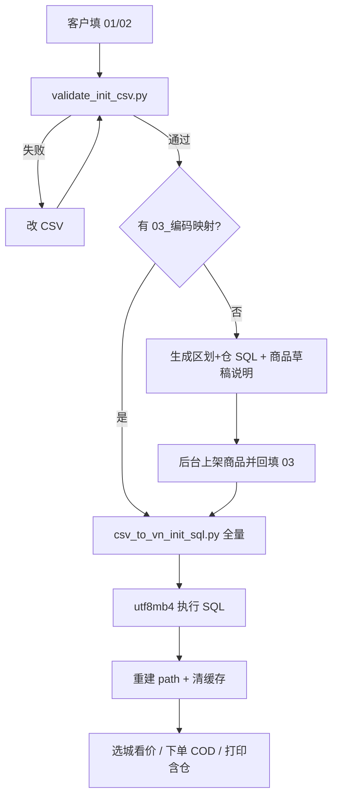

# 越南模式初始业务数据：收集模板 + CSV→SQL 工具

落点：[docs/260409-菜集鲜/初始业务数据模板/](docs/260409-菜集鲜/初始业务数据模板/)

性质：客户/运营填表 → 校验脚本 →（人工或 AI 补商品上架细节后）生成幂等 SQL / 或对照后台导入。**收集 CSV ≠ 后台 Excel 导入格式**，但列设计要让脚本/AI 可稳定映射。

---

## 1. 相对前一版的变更

| 点 | 决定 |
|----|------|
| CSV2 区划 | **拆成省/直辖市 + 郡/县级**两级列，禁止「单独一个城名」 |
| Demo | 按客户口述：河内、北宁、顺化、胡志明 + 土豆、洋葱等 |
| 转换 | **要做** Python 校验/转 SQL + MD 流程文档（不只收集表） |
| 商品入库 | 脚本**不伪造完整商品上架**（图片/详情/运费模板等）；区域价 SQL 依赖「编码→product_id/unique」映射表 |

---

## 2. 目录结构（执行时创建）

```text
docs/260409-菜集鲜/初始业务数据模板/
  README.md                 # 给客户/运营：怎么填
  转换流程.md               # 给技术/AI：校验→映射→SQL 顺序与表字段
  01_商品规格.csv
  02_省郡_仓_区域价.csv
  tools/
    validate_init_csv.py
    csv_to_vn_init_sql.py
    requirements.txt        # 仅标准库优先；若要 csv 更好解析可注明无第三方
  out/                      # gitignore 或仅示例；脚本默认输出于此
    .gitkeep
```

编码：UTF-8 **带 BOM**（Excel 打开越文不乱码）。

---

## 3. CSV1 `01_商品规格.csv`

一行 = 一个可售规格。价列主键 = `商品编码` + `规格编码`。

| 列头（中\|越） | 必填 | 说明 |
|----------------|------|------|
| 商品编码\|Mã SP | 是 | 如 `POTATO`；与 CSV2 价列一致 |
| 规格编码\|Mã quy cách | 是 | 单规格填 `DEFAULT` |
| 商品名_越\|Tên SP (VI) | 是 | |
| 商品名_中\|Tên SP (ZH) | 建议 | |
| 分类_越\|Danh mục (VI) | 是 | 文本；脚本可生成分类 INSERT 草稿 |
| 分类_中\|Danh mục (ZH) | 否 | |
| 规格名_越\|Quy cách (VI) | 是 | |
| 规格名_中\|Quy cách (ZH) | 否 | |
| 单位\|Đơn vị | 是 | `kg` 等 |
| 参考价_VND\|Giá tham chiếu | 建议 | 写入商品主表价草稿 |
| 划线价_VND\|Giá gạch | 否 | |
| 库存\|Tồn kho | 建议 | |
| 产地_越\|Xuất xứ (VI) | 否 | |
| 是否生鲜\|Hàng tươi | 否 | `1`/`0` |
| 备注\|Ghi chú | 否 | |

**Demo 行（客户举例）**：至少 `POTATO`/`ONION` 两品，可再加 `TOMATO` 等凑 3～4 行示意「十个左右品类」的填法。

---

## 4. CSV2 `02_省郡_仓_区域价.csv`（省市分层）

一行 = 一个**挂价/挂默认仓的销售节点**。区划用两级列表达（对齐库内 `level`：0=省/直辖市，1=郡/县）。

### 4.1 固定列

| 列头（中\|越） | 必填 | 说明 |
|----------------|------|------|
| 区划编码\|Mã vùng | 是 | 收集侧稳定键，如 `VN-HN`、`VN-HN-BD`；**转 SQL 时映射 city_id**，不要只靠名称 |
| 省_越\|Tỉnh/TP (VI) | 是 | level0 名称，如 `Hà Nội`、`Bắc Ninh` |
| 省_中\|Tỉnh/TP (ZH) | 建议 | `河内`、`北宁` |
| 郡_越\|Quận/Huyện (VI) | 否 | **空=价与仓挂在省级**；有值则挂在该郡（需能归属到上面的省） |
| 郡_中\|Quận/Huyện (ZH) | 否 | |
| 是否开放\|Mở bán | 是 | `1`/`0` |
| 是否热门\|Nổi bật | 否 | 定位兜底；客户主城建议 `1` |
| 仓编码\|Mã kho | 是 | 如 `WH-HN`；同仓多行挂不同区时可重复 |
| 仓名_越\|Tên kho (VI) | 是 | |
| 仓名_中\|Tên kho (ZH) | 否 | |
| 仓地址_越\|Địa chỉ kho (VI) | 是 | |
| 仓电话\|SĐT kho | 否 | |
| 经度\|Kinh độ | 否 | |
| 纬度\|Vĩ độ | 否 | |

挂载规则（写进 README + 脚本）：

- `郡_*` 为空 → 节点 = 该省（level0），价/默认仓挂省。
- `郡_*` 有值 → 节点 = 该郡（level1），脚本确保先有省再有郡；价/仓挂郡（祖先链取价仍可用）。

客户「切城」主路径仍是 level≤1；demo 默认**四行省级**即可，另加 1 行「河内-某郡」示范郡级填法（可选）。

### 4.2 动态价列

对 CSV1 每个 `商品编码_规格编码`：

- `价_POTATO_DEFAULT\|Giá_POTATO_DEFAULT`
- `划线_POTATO_DEFAULT\|GiáGạch_POTATO_DEFAULT`（可选）

空 = 该节点不售；禁止填 `0`。

### 4.3 Demo 行（对齐客户口述）

| 区划编码 | 省 | 仓 | 说明 |
|----------|-----|-----|------|
| `VN-HN` | 河内 / Hà Nội | WH-HN | 热门 |
| `VN-BN` | 北宁 / Bắc Ninh | WH-BN | |
| `VN-HUE` | 顺化 / Thừa Thiên Huế（名用 `Huế` 或全称，demo 注明） | WH-HUE | |
| `VN-HCM` | 胡志明 / TP. Hồ Chí Minh | WH-HCM | 热门 |

各行给土豆/洋葱填不同 VND 价，体现「城报价不一样」。

---

## 5. 收集齐后还缺什么（转 SQL 前必须补）

脚本/AI **无法单靠两张 CSV 闭环**的部分，要在 `转换流程.md` 写清：

| 缺口 | 为何 | 补法 |
|------|------|------|
| 商品主图/轮播/详情 HTML | CRMEB 上架字段多 | 后台手工上架，或另给「最小可售」SQL 模板 + 占位图 |
| `product_id` / 规格 `unique` | 库内自增/哈希 | 上架后导出映射 CSV：`商品编码,规格编码,product_id,unique`；或脚本参数 `--id-map` |
| 分类真实 `cate_id` | 仅有分类名 | 脚本按名匹配已有分类，或先 INSERT 分类再回填 |
| 完整坊级地址树 | 用户选地址可能要到坊 | 收集表不够；另导官方行政区或后台维护；**销售/定价可先只到省** |
| `path` 重建 | 区划父子变更后 | SQL 后执行后台「重建 path」或 `region:rebuild_path` |
| 国家根 `900002` | VN 根须已存在 | 依赖已跑 `020_region.sql` |
| 线下支付 / vn 开关 | 配置非 CSV | 确认 `offline_pay_status`、`vn_mode_enable` 等 |
| 多语 `eb_i18n_content` | CSV 有中越名 | 脚本可生成 i18n INSERT 草稿（product/warehouse/city） |
| 一城多仓 | 模板一行一默认仓 | 同省多行不同仓编码时：`is_default` 仅第一行或显式加列「是否默认仓」——**执行时在 CSV2 增加列 `是否默认仓\|Kho mặc định`** |
| 联系方式/协议 | 非主链路 | 后台 `vn_contact` + agreements HTML，不进本工具 |

**建议增加的第三张可选映射表**（技术填，不给客户）：

- `03_编码映射.csv`：`商品编码,规格编码,product_id,unique` + 可选 `区划编码,city_id`  
  有它才能生成可直接执行的区域价 SQL；没有则脚本只输出「待填 id 的草稿」或校验通过的中间 JSON。

---

## 6. SQL 转换流程（写入 `转换流程.md`）



### 推荐生成 SQL 分段（幂等）

1. **区划**：按省去重 INSERT `eb_system_city`（level0，`parent_id=900002`，`country_code=VN`）；再 INSERT 郡（level1）；`is_open`/`is_hot`/`lng`/`lat`/`name`；`city_id` 用约定号段或映射表（demo 可用 `92xxxx` 避免与种子 `91xxxx` 冲突，或文档约定「空库用 910001 起」）。
2. **仓**：`eb_vn_warehouse`（按仓编码去重）+ `eb_vn_warehouse_region`（区划编码→city_id，`is_default`）。
3. **商品**（可选弱生成）：仅当 `--emit-product-stub=1` 时输出需人工改的 stub；默认跳过。
4. **区域价**：宽表转长表 → `eb_store_product_region_price`（依赖 03 映射）；`status=1`。
5. **i18n 草稿**（可选）：`eb_i18n_content` 商品名/仓名。

执行注意：客户端 `SET NAMES utf8mb4`；跑完清 `runtime/cache` 与 `lang_version`。

---

## 7. Python 工具约定

### `validate_init_csv.py`

- 读 01/02（及可选 03）。
- 检查：必填列、01 编码唯一、02 价列都能在 01 找到、省_越非空、区划编码唯一、开放行必须有仓名地址、价为空或正数、默认仓规则。
- 退出码非 0 + 打印行号；支持 `--json` 给 AI。

### `csv_to_vn_init_sql.py`

- 参数：`--products` `--regions` `--id-map` `--out-dir` `--city-id-base` `--dry-run`。
- 输出：`01_region.sql`、`02_warehouse.sql`、`03_region_price.sql`（有 map 时）、`00_report.md`（行数、跳过空价、未映射编码列表）。
- 只用标准库（`csv`/`argparse`/`pathlib`），Windows PowerShell 可直接 `python tools/...`。

不在本期做：直接连 MySQL 写入、调用后台 HTTP 导入 API。

---

## 8. 文档职责划分

| 文档 | 读者 | 内容 |
|------|------|------|
| `README.md` | 客户/运营 | 列说明、省市怎么填、空价含义、demo 含义、填表顺序 |
| `转换流程.md` | 技术/AI | 表映射、city_id 号段、03 映射、脚本命令、执行与回滚、与 `RegionPriceAdminServices` 长表差异 |

---

## 9. 执行范围（确认后落地）

- 只新增上述目录内 md/csv/py，**不改业务 PHP/前端**。
- Demo 数据用虚构地址与价格，仅作填表示范。
- 用 demo 跑通 validate + 生成示例 SQL 片段，便于你后续「收集真表 → AI/脚本出正式 SQL」。
